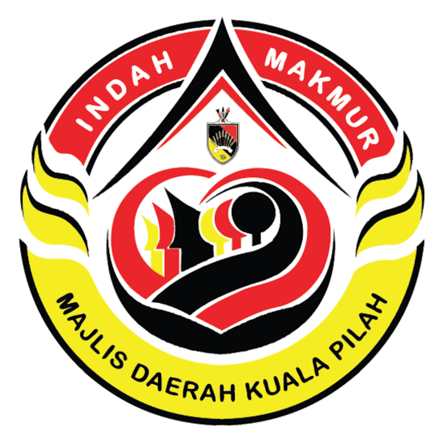

<p align="center">
  
</p>

# Majlis Daerah Kuala Pilah (MDKP)

A municipal dashboard prototype for AI-assisted vehicle number plate recognition and evidence review. Built with Laravel 13 and PHP 8.5, with a light-mode layout adapted from [Neoeagle](https://neoeagle.iotnect.com/).

**This is a working dashboard mockup.** Authentication, database records, review decisions, filtering, and CSV exports work. Live cameras and an OCR engine are not connected; vehicle previews use an illustrative photograph.

## Features

| Area | Functionality |
| --- | --- |
| Login | Session authentication, remember me, password visibility, failed-attempt limits, and logout. |
| Overview | Capture totals, camera counts, pending reviews, average confidence, activity chart, and alerts. |
| Plate detection | Search plates; filter by camera, review status, or capture date; paginate results. |
| Evidence review | Inspect capture metadata, add review notes, and verify or dismiss detections. Decisions persist in SQLite. |
| Camera monitoring | Browse illustrative camera previews and filter associated captures by plate, location, or camera. |
| Vehicle watchlist | Inspect detection matches for seeded flagged vehicles. |
| Review activity | View current saved review decisions and notes, ordered by latest update. |
| Reports | Export detection, watchlist, and verified-evidence CSV reports within a selected date range. |
| Settings | Light/dark appearance and a default-camera preference, saved in the browser. |

The interface includes responsive navigation and layouts for desktop and mobile screens.

## Requirements

- PHP **8.5+**, below PHP 9, with the extensions required by Composer.
- PDO SQLite and SQLite support for the default local database.
- Composer 2 and Git.
- Internet access for Google Fonts and Material Symbols.

The dashboard and login load committed CSS and JavaScript directly from `public/assets`. **An npm installation or Vite build is not required to run these pages.** Node.js and npm are optional for the Laravel Vite scaffolding in `resources/css` and `resources/js`.

## Local setup

Run these commands in PowerShell. The same PHP and Composer steps work with Laragon's terminal.

```powershell
git clone https://github.com/Iotnect/mdkp.git mdkp
cd mdkp

composer install
Copy-Item .env.example .env
php artisan key:generate
php -r "file_exists('database/database.sqlite') || touch('database/database.sqlite');"
php artisan migrate

php artisan db:seed --class=AdminUserSeeder
php artisan db:seed --class=DetectionSeeder

php artisan serve
```

On macOS or Linux, replace `Copy-Item .env.example .env` with `cp .env.example .env`.

The default database connection in `.env.example` is SQLite. Set these application values in your local `.env`:

```dotenv
APP_NAME="Majlis Daerah Kuala Pilah"
APP_URL=http://127.0.0.1:8000
DB_CONNECTION=sqlite
```

Open **http://127.0.0.1:8000/login**. Guests visiting the dashboard are redirected to sign in. If using Laragon's Apache virtual host instead, point its document root to this project's `public` directory and set `APP_URL` to that host.

### Demo credentials

| Field | Value |
| --- | --- |
| Username | `admin` |
| Password | `admin123` |

`AdminUserSeeder` creates the account with a hashed password and leaves an existing account unchanged. These credentials are for local demonstrations; replace them before using the application with real data.

### Sample data

`DetectionSeeder` creates **12 captures across 4 camera locations**, including **2 watchlist matches**. The sample captures are dated **23 October 2026**, and the overview chart covers **19–25 October 2026**. Capture times are stored in UTC and displayed in Malaysia time (MYT, UTC+8).

To restore the original demo detections:

```powershell
php artisan db:seed --class=DetectionSeeder
```

Reseeding updates the sample rows and resets their review statuses and notes. The setup deliberately calls both seeders explicitly; the default `DatabaseSeeder` does not seed detections.

## Validation

```powershell
composer validate --strict
composer check-platform-reqs
php artisan test --compact
```

The current suite contains **14 tests**, covering authentication, login throttling, guest access protection, detection display, evidence updates, validation, and logout. Tests use an isolated in-memory SQLite database.

To format PHP changes:

```powershell
php vendor/bin/pint --dirty --format agent
```

## Project structure

| Path | Purpose |
| --- | --- |
| `app/Http/Controllers/AuthenticatedSessionController.php` | Login, logout, and failed-attempt limits. |
| `app/Http/Controllers/DashboardController.php` | Dashboard data and evidence review updates. |
| `app/Http/Requests/` | Login and review input validation. |
| `app/Models/Detection.php` | Plate detection records and attribute casts. |
| `database/migrations/` | Database schema. |
| `database/seeders/` | Demo administrator and detection data. |
| `resources/views/` | Login and dashboard Blade templates. |
| `public/assets/neoeagle.css` | Reference UI stylesheet. |
| `public/assets/mdkp.css` | Council-specific interface additions. |
| `public/assets/dashboard.js` | Dashboard views, filtering, dialogs, preferences, and CSV exports. |
| `routes/web.php` | Guest and authenticated routes. |
| `tests/Feature/` | Authentication and dashboard feature tests. |

## Prototype scope

- OCR results, camera locations, confidence scores, and watchlist flags are seeded examples. There is no live detection pipeline or camera stream.
- Evidence previews reuse one illustrative vehicle image; they are not original camera captures of the displayed plates.
- Review activity shows the latest saved decision for each record, rather than an immutable audit history.
- Watchlist matches are available for review; watchlist creation and editing are not implemented.
- Report generation runs in the browser using the dashboard's loaded records.
- Role-based user management and production deployment configuration are not implemented.

The local `.env`, SQLite database, dependencies, logs, and generated preview screenshots are excluded from Git. Run the setup steps after cloning to recreate the local environment.
